```{=html}
<section class="hero">
  <div class="hero-inner">
    <div class="hero-text">
    <div class="eyebrow">Second edition</div>
    <h1>Quantum Symposium for Young Investigators</h1>
    <div class="edition">QSYI 2027</div>
    <div class="meta">March 15 to 19, 2027 &nbsp;·&nbsp; TTJ Auditorium, ICSR Building, IIT Madras, Chennai</div>
    <div class="btns">
      <a class="btn-q btn-q-light" href="application.html">Apply now</a>
      <a class="btn-q btn-q-outline" href="program.html">View program</a>
    </div>
    </div>
    <div class="hero-side">
      <div class="hero-logo">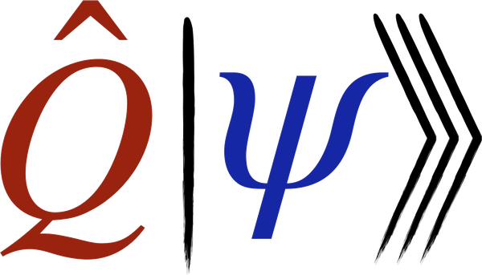</div>
      <div class="countdown" id="countdown">
        <div class="cd-head">Starts in</div>
        <div class="cd-row">
          <div class="unit"><div class="num" id="cd-d">--</div><div class="lbl">Days</div></div>
          <div class="unit"><div class="num" id="cd-h">--</div><div class="lbl">Hours</div></div>
          <div class="unit"><div class="num" id="cd-m">--</div><div class="lbl">Minutes</div></div>
          <div class="unit"><div class="num" id="cd-s">--</div><div class="lbl">Seconds</div></div>
        </div>
      </div>
    </div>
  </div>
</section>
```

## About QSYI

The **Quantum Symposium for Young Investigators (QSYI)** returns to [IIT Madras](https://www.iitm.ac.in/), Chennai, for its second edition, from [March 15 to 19, 2027]{.hl}.

QSYI brings together **early-career researchers** in quantum science and technology, with a special focus on young faculty members and group leaders who have recently set up their own research groups. The symposium offers them a platform to present their work, share their **future research directions**, and build **collaborations** across India and abroad.

The scientific program spans a broad range of topics, from quantum simulation and many-body physics to quantum computation, information, communication, sensing and control, with both **theory and experiment** represented.

The program features [invited talks](speakers.html#invited-speakers), contributed talks, [two public colloquia](speakers.html#eminent-colloquium-speakers) by eminent physicists, and poster sessions. Invited speakers are encouraged to bring a student or postdoc from their group to present a poster. Other researchers can [apply](application.html) to present a poster, give a contributed talk or attend, and participants are **selected by the organizing committee**. **All talks will be streamed live.**

The [first edition](https://sites.google.com/physics.iitm.ac.in/qsyi-2025/) was held at IIT Madras in March 2025 as a two-day national meeting. QSYI 2027 is hosted by the [Center for Quantum Information, Communication and Computing (CQuICC)](https://quantum.iitm.ac.in/home), IIT Madras.

```{=html}
<div class="qgrid qgrid-4">
  <div class="qcard stat"><div class="num">5</div><div class="lbl">days</div></div>
  <div class="qcard stat"><div class="num">24</div><div class="lbl">invited speakers</div></div>
  <div class="qcard stat"><div class="num">2</div><div class="lbl">public colloquia</div></div>
  <div class="qcard stat"><div class="num">Live</div><div class="lbl">streamed</div></div>
</div>
```

## Themes

QSYI covers the breadth of quantum science and technology, with an emphasis on the interface between **fundamental physics** and **emerging quantum technologies**.

```{=html}
<div class="qgrid qgrid-3 themes">
  <div class="qcard theme-card"><h4>Quantum simulation</h4><p>Analog and digital quantum simulation with trapped ions, ultracold and Rydberg atoms and other platforms, from lattice gauge theories to quantum many-body models.</p></div>
  <div class="qcard theme-card"><h4>Quantum sensing and metrology</h4><p>Entanglement-enhanced sensing, optical clocks and precision spectroscopy, and spin-based sensors such as NV centers in diamond.</p></div>
  <div class="qcard theme-card"><h4>Quantum computation and algorithms</h4><p>Quantum algorithms, error correction and mitigation on near-term hardware, and applications to quantum chemistry and quantum machine learning.</p></div>
  <div class="qcard theme-card"><h4>Quantum information and communication</h4><p>Entanglement and quantum correlations, resource theories, quantum communication and cryptography, and quantum thermodynamics.</p></div>
  <div class="qcard theme-card"><h4>Quantum many-body physics</h4><p>Strongly correlated and topological matter, non-equilibrium dynamics and thermalization, and open and driven-dissipative quantum systems.</p></div>
  <div class="qcard theme-card"><h4>Quantum control and dynamics</h4><p>Coherent and optimal control of atoms, molecules and qubits, light-matter interaction in cavities, and ultrafast quantum dynamics.</p></div>
</div>
```

## Key dates

```{=html}
<table class="dtable">
  <thead>
    <tr><th></th><th>Need a visa to visit India</th><th>Do not need a visa</th></tr>
  </thead>
  <tbody>
    <tr><th>Application deadline</th><td>December 15, 2026</td><td>January 15, 2027</td></tr>
    <tr><th>Notification of selection</th><td>December 20, 2026</td><td>January 25, 2027</td></tr>
    <tr><th>Registration deadline</th><td>December 31, 2026</td><td>January 31, 2027</td></tr>
  </tbody>
</table>
```

After selection, participants will receive a **link by email to register and pay the registration fee**. There is [no registration fee]{.hl-blue} for invited speakers and their accompanying group members.

For details on how to apply, see the [Application](application.html) page.

## Organizing committee

```{=html}
<div class="people max3">
  <a class="qcard speaker" href="https://titaschanda.github.io">
    <div class="avatar">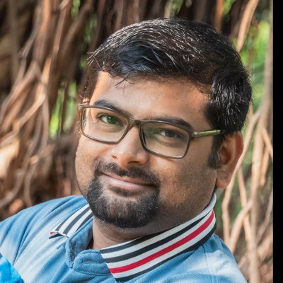</div>
    <div class="name">Titas Chanda</div>
    <div class="aff">Department of Physics, IIT Madras</div>
  </a>
  <a class="qcard speaker" href="https://sites.google.com/physics.iitm.ac.in/quantum-optics-theory-iitm/about">
    <div class="avatar">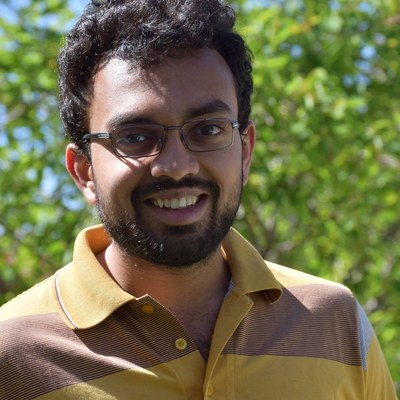</div>
    <div class="name">Athreya Shankar</div>
    <div class="aff">Department of Physics, IIT Madras</div>
  </a>
  <a class="qcard speaker" href="https://sites.google.com/smail.iitm.ac.in/spins-photons-yet-more">
    <div class="avatar">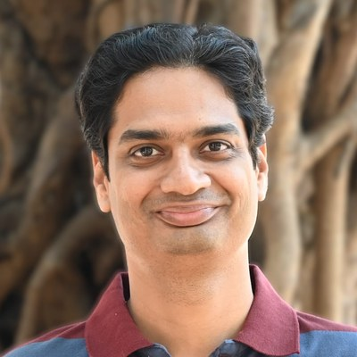</div>
    <div class="name">Siddharth Dhomkar</div>
    <div class="aff">Department of Physics, IIT Madras</div>
  </a>
  <a class="qcard speaker" href="https://sites.google.com/view/pranay-patil-research-group/about">
    <div class="avatar">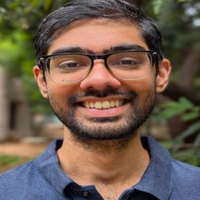</div>
    <div class="name">Pranay Patil</div>
    <div class="aff">Department of Physics, IIT Madras</div>
  </a>
  <a class="qcard speaker" href="https://nkrishna88.wixsite.com/website">
    <div class="avatar">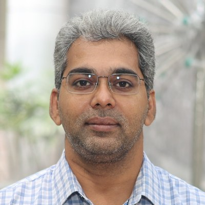</div>
    <div class="name">Krishna R. Nandipati</div>
    <div class="aff">Department of Chemistry, IIT Madras</div>
  </a>
  <a class="qcard speaker" href="https://sites.google.com/smail.iitm.ac.in/caqsat/home">
    <div class="avatar">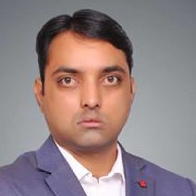</div>
    <div class="name">Rahul Sawant</div>
    <div class="aff">Department of Physics, IIT Madras</div>
  </a>
</div>
```

## Advisory committee

```{=html}
<div class="people">
  <a class="qcard speaker" href="https://physics.iitm.ac.in/~arul/">
    <div class="avatar">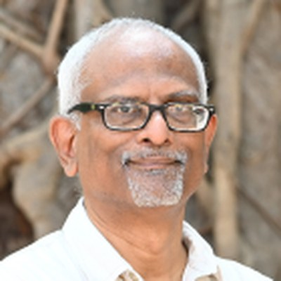</div>
    <div class="name">Arul Lakshminarayan</div>
    <div class="aff">Department of Physics, IIT Madras</div>
  </a>
  <a class="qcard speaker" href="https://sites.google.com/ee.iitm.ac.in/anilprabhakar">
    <div class="avatar">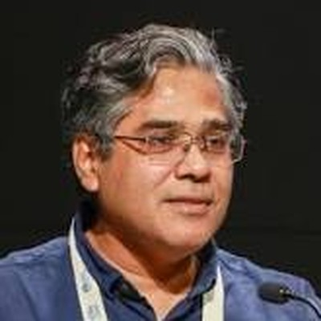</div>
    <div class="name">Anil Prabhakar</div>
    <div class="aff">Department of Electrical Engineering, IIT Madras</div>
  </a>
  <a class="qcard speaker" href="https://physics.iitm.ac.in/~prabhamd/">
    <div class="avatar">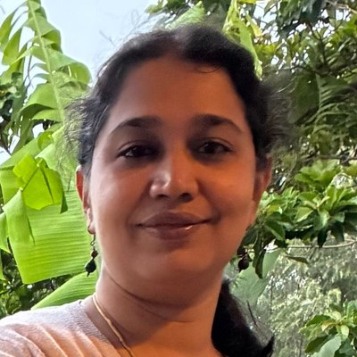</div>
    <div class="name">Prabha Mandayam</div>
    <div class="aff">Department of Physics, IIT Madras</div>
  </a>
  <a class="qcard speaker" href="https://physics.iitm.ac.in/people/facultyinfo/rnarayanan.html">
    <div class="avatar">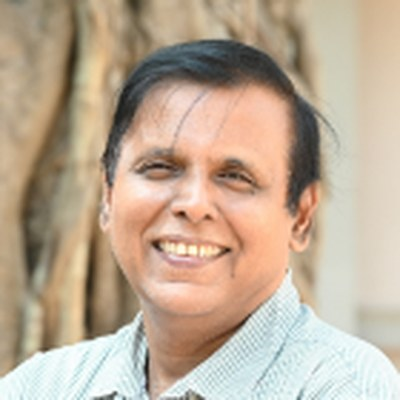</div>
    <div class="name">Rajesh Narayanan</div>
    <div class="aff">Department of Physics, IIT Madras</div>
  </a>
</div>
```

## Supported by

```{=html}
<div class="supporters">
  <a href="https://www.mphasis.com/home/corporate/community-social-responsibility.html">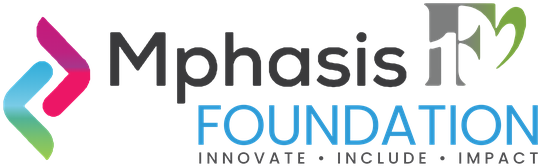</a>
  <a href="https://ge.iitm.ac.in/">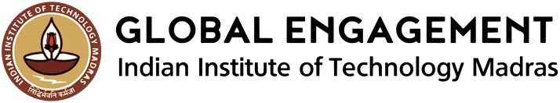</a>
  <a href="https://quantum.iitm.ac.in/home">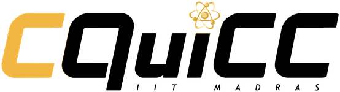</a>
  <a href="https://www.iitm.ac.in/">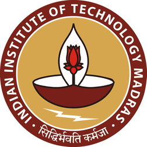</a>
</div>
<a class="lookback" href="https://sites.google.com/physics.iitm.ac.in/qsyi-2025/">
  <div>
    <div class="lb-eyebrow">Looking back</div>
    <div class="lb-title">QSYI 2025</div>
    <div class="lb-text">The first edition, held at IIT Madras on March 7 and 8, 2025</div>
  </div>
  <span class="lb-btn">Visit the QSYI 2025 website &rarr;</span>
</a>
```

```{=html}
<script>
// Countdown to the opening session: March 15, 2027, 9:00 AM IST
(function () {
  const target = new Date("2027-03-15T09:00:00+05:30").getTime();
  const el = id => document.getElementById(id);
  if (!el("cd-d")) return;
  function tick() {
    let d = Math.max(0, target - Date.now());
    const days = Math.floor(d / 864e5); d -= days * 864e5;
    const h = Math.floor(d / 36e5); d -= h * 36e5;
    const m = Math.floor(d / 6e4); d -= m * 6e4;
    const s = Math.floor(d / 1e3);
    el("cd-d").textContent = days;
    el("cd-h").textContent = String(h).padStart(2, "0");
    el("cd-m").textContent = String(m).padStart(2, "0");
    el("cd-s").textContent = String(s).padStart(2, "0");
  }
  tick(); setInterval(tick, 1000);
})();
</script>
```

```{=html}
<script type="application/ld+json">
{
  "@context": "https://schema.org",
  "@type": "Event",
  "name": "Quantum Symposium for Young Investigators 2027 (QSYI 2027)",
  "alternateName": "QSYI 2027",
  "description": "The second Quantum Symposium for Young Investigators, a five-day meeting for early-career researchers in quantum science and technology, with invited talks, contributed talks, two public colloquia and poster sessions. All talks are streamed live.",
  "url": "https://qsyi-iitm.github.io/2027/",
  "image": ["https://qsyi-iitm.github.io/2027/assets/og-image.jpg"],
  "startDate": "2027-03-15T09:00:00+05:30",
  "endDate": "2027-03-19T18:00:00+05:30",
  "eventStatus": "https://schema.org/EventScheduled",
  "eventAttendanceMode": "https://schema.org/MixedEventAttendanceMode",
  "inLanguage": "en",
  "location": [
    {
      "@type": "Place",
      "name": "TTJ Auditorium, ICSR Building, IIT Madras",
      "address": {
        "@type": "PostalAddress",
        "streetAddress": "Sardar Patel Road, Adyar",
        "addressLocality": "Chennai",
        "addressRegion": "Tamil Nadu",
        "postalCode": "600036",
        "addressCountry": "IN"
      }
    },
    { "@type": "VirtualLocation", "url": "https://qsyi-iitm.github.io/2027/program.html" }
  ],
  "organizer": {
    "@type": "Organization",
    "name": "Center for Quantum Information, Communication and Computing (CQuICC), IIT Madras",
    "url": "https://quantum.iitm.ac.in/home"
  },
  "performer": [
    { "@type": "Person", "name": "Ana Maria Rey" },
    { "@type": "Person", "name": "Jainendra K. Jain" }
  ],
  "offers": [
    { "@type": "Offer", "name": "Students and postdocs", "price": "2000", "priceCurrency": "INR", "url": "https://qsyi-iitm.github.io/2027/application.html" },
    { "@type": "Offer", "name": "Faculty", "price": "3000", "priceCurrency": "INR", "url": "https://qsyi-iitm.github.io/2027/application.html" },
    { "@type": "Offer", "name": "Industry delegates", "price": "5000", "priceCurrency": "INR", "url": "https://qsyi-iitm.github.io/2027/application.html" }
  ],
  "superEvent": {
    "@type": "EventSeries",
    "name": "Quantum Symposium for Young Investigators",
    "url": "https://qsyi-iitm.github.io/"
  }
}
</script>
```
