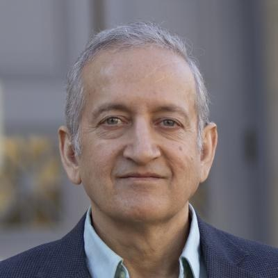

```{=html}
<section class="page-hero">
  <h1>Speakers</h1>
  <p>Early-career group leaders from India and abroad, and two eminent colloquium speakers</p>
</section>
```

## Eminent colloquium speakers

The two **public colloquia** are open to everyone on the IIT Madras campus.

```{=html}
<div class="people">
  <a class="qcard speaker eminent" href="https://www.colorado.edu/jila/arey">
    <div class="avatar"></div>
    <div class="name">Ana Maria Rey</div>
    <div class="aff">University of Colorado Boulder, USA</div>
  </a>
  <a class="qcard speaker eminent" href="https://science.psu.edu/physics/people/jkj2">
    <div class="avatar"></div>
    <div class="name">Jainendra K. Jain</div>
    <div class="aff">Pennsylvania State University, USA</div>
  </a>
</div>
```

## Invited speakers

::: {#invited}
:::
